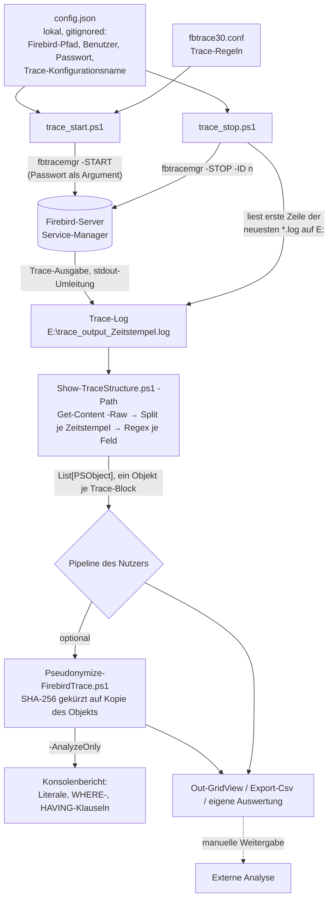

# Architektur-Übersicht – PSFirebirdTraceParser

PowerShell-Skripte, die Firebird-Trace-Logs (Textdateien des Firebird-Trace-API) in strukturierte
PowerShell-Objekte zerlegen, diese vor einer Weitergabe pseudonymisieren und Trace-Sessions auf einem
Firebird-Server per `fbtracemgr` starten und stoppen. Kein Dienst, keine Datenbank-Persistenz, kein Modul.

---

## Stack

| Schicht | Technologie |
|---------|-------------|
| Trace-Erfassung | `trace_start.ps1` / `trace_stop.ps1` → `fbtracemgr.exe` (Firebird Services API, lokal `service_mgr`) |
| Parsing | `Show-TraceStructure.ps1` — .NET-Regex (`System.Text.RegularExpressions`, kompiliert) |
| Pseudonymisierung | `Pseudonymize-FirebirdTrace.ps1` — SHA-256 (`System.Security.Cryptography`), gekürzt |
| Laufzeit | Windows PowerShell 5.1 oder PowerShell 7.x (keine PSGallery-Module) |
| Datenbank | keine eigene; liest nur Trace-Ausgaben eines Firebird-Servers (Beispielkonfiguration: Firebird 4.0) |
| Auth | Firebird-Benutzer/Passwort aus lokaler `config.json` für `fbtracemgr` (nur Trace-Skripte) |
| Build | keine (Skripte werden direkt ausgeführt) |

---

## Scope-Grenzen — Was dieses System NICHT tut

Bewusste Negativ-Liste. Sie verhindert Scope Creep und macht
Architekturentscheidungen nachvollziehbar.

- **Keine Auswertung/Reports:** Das Repository liefert Objekte (`[PSCustomObject]`); Analysen, Gruppierungen und
  Reports baut der Nutzer selbst (README: „Core Parsing Engine"). Frühere Analyse-Skripte wurden bewusst entfernt.
- **Keine Anonymisierung:** Der Pseudonymisierer ersetzt Werte deterministisch; Ergebnisse bleiben personenbezogene
  Daten (`security/DATA_HANDLING.md`).
- **Keine Datenbankverbindung:** Kein Skript liest oder schreibt Datenbankinhalte; die Trace-Skripte sprechen nur den
  Service-Manager an (Start/Stopp einer Trace-Session).
- **Keine Remote-Steuerung:** `fbtracemgr` wird nur lokal (`-SE service_mgr`) aufgerufen; kein WinRM/SSH.
- **Kein Upload:** Weitergabe an externe Analysedienste geschieht manuell durch den Nutzer, nicht durch die Skripte.
- **Keine Unterstützung für Firebird-2.x-Trace-Formate:** Der Zeitstempel-Trenner erwartet das Format
  `JJJJ-MM-TTThh:mm:ss.ffff` (Firebird 3+); ältere Formate sind ungetestet.

Änderungen an dieser Liste sind eine Architekturentscheidung → ADR erforderlich.

---

## Systemstruktur (Datenfluss)



---

## Modul-Verantwortlichkeiten

```
Show-TraceStructure.ps1         → Zerlegt eine Trace-Datei in Blöcke (Zeitstempel-Trenner) und mappt Felder per Regex auf ein Objekt je Block.
Pseudonymize-FirebirdTrace.ps1  → Ersetzt identifizierende Werte der Parser-Objekte durch gekürzte SHA-256-Hashes; -AnalyzeOnly zeigt nur, was ersetzt würde.
trace_start.ps1                 → Lädt config.json und startet eine Trace-Session mit fbtrace30.conf; Ausgabe in eine Datei mit Zeitstempel.
trace_stop.ps1                  → Liest die Session-ID aus der Kopfzeile der neuesten Trace-Datei und stoppt die Session.
fbtrace30.conf                  → Legt fest, was Firebird protokolliert (Schwellwert 100 ms, Statements, Pläne, Performance, Transaktionen, Fehler).
```

---

## Entscheidungsrelevante Constraints

| Constraint | Auswirkung |
|-----------|-----------|
| Trace-Logs werden mehrere GB groß | Parser hält heute Datei + Blockliste + Ergebnisliste gleichzeitig im Speicher (K2) — Streaming ist I6 |
| Trace-Inhalte enthalten SQL-Literale, Parameter, Benutzer, IPs, Anwendungspfade | Personenbezogene/vertrauliche Daten; Weitergabe nur pseudonymisiert und mit Freigabe (`security/DATA_HANDLING.md`) |
| Ausgabe-Properties des Parsers sind Eingabe des Pseudonymisierers und von Nutzer-Exporten | Property-Namen sind ein Vertrag (`features/TRACE_PARSING.md`) |
| Lauffähig unter Windows PowerShell 5.1 **und** PowerShell 7 | Keine PS-7-only-Syntax (`??`, `?.`, Ternary); Encoding-Unterschiede beachten (`CONVENTIONS.md` §3) |
| `fbtracemgr -START` läuft im Vordergrund, bis die Session gestoppt wird | `trace_start.ps1` blockiert die Konsole; Stoppen aus einer zweiten Konsole (`operations/RUNBOOK.md`) |
| Öffentliches Repository | Keine Interna in Code, Doku, Commits; Interna-Hook (`CONVENTIONS_COMMON.md` 3.1) |

---

## Lese-Pfad für Architektur-Details

Wenn du tiefer einsteigen willst, lies in dieser Reihenfolge — jeder Schritt
baut auf dem vorigen auf:

1. **Diese Datei** (`OVERVIEW.md`) — Big Picture, Scope-Grenzen, Datenfluss.
2. `architecture/PROJECT_LAYOUT.md` — wo welche Schicht und welcher Code liegt.
3. `architecture/CONFIGURATION.md` — `config.json`, Parameter, Trace-Konfiguration.
4. `architecture/ERROR_HANDLING.md` — Exit-Codes und Fehlerverhalten der Skripte.
5. `architecture/ADR/` — Architekturentscheidungen (bisher nur die Vorlage `ADR-000-template.md`).
6. **Stack-spezifische Architektur-Docs:** `architecture/DEPENDENCIES.md` (PowerShell, .NET, `fbtracemgr`),
   `architecture/CREDENTIAL_STRATEGY.md` (Firebird-Zugangsdaten der Trace-Skripte).
7. Feature-Details: `features/TRACE_PARSING.md`, `features/PSEUDONYMIZATION.md`, `features/TRACE_CAPTURE.md`.

Begriffe und Geschäftssprache: `docs/GLOSSARY.md`.
Bekannte Einschränkungen und Probleme: `docs/KNOWN_ISSUES.md`.
