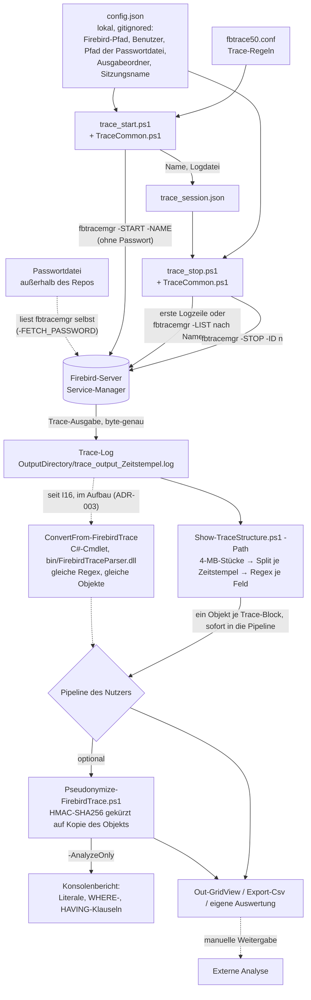

# Architektur-Übersicht – PSFirebirdTraceParser

PowerShell-Skripte, die Firebird-Trace-Logs (Textdateien des Firebird-Trace-API) in strukturierte
PowerShell-Objekte zerlegen, diese vor einer Weitergabe pseudonymisieren und Trace-Sessions auf einem
Firebird-Server per `fbtracemgr` starten und stoppen. Kein Dienst, keine Datenbank-Persistenz, kein Modul.

---

## Stack

| Schicht | Technologie |
|---------|-------------|
| Trace-Erfassung | `trace_start.ps1` / `trace_stop.ps1` + `TraceCommon.ps1` → `fbtracemgr.exe` (Firebird Services API, lokal `service_mgr`) |
| Parsing | `Show-TraceStructure.ps1` — .NET-Regex (`System.Text.RegularExpressions`, kompiliert); seit I16 parallel C#-Parser `src/FirebirdTraceParser` (Binär-Cmdlet, `net8.0`, nur PowerShell 7, ADR-003) mit denselben Regex |
| Pseudonymisierung | `Pseudonymize-FirebirdTrace.ps1` — HMAC-SHA256 mit Schlüssel (`System.Security.Cryptography`), gekürzt (ADR-001) |
| Laufzeit | Windows PowerShell 5.1 oder PowerShell 7.x (keine PSGallery-Module); Trace-Skripte PowerShell 7.4+ |
| Datenbank | keine eigene; liest nur Trace-Ausgaben eines Firebird-Servers (Beispielkonfiguration: Firebird 5.0) |
| Auth | nur Trace-Skripte: Firebird-Benutzer + Passwortdatei (`-FETCH_PASSWORD`) oder Windows-Anmeldung (`-TRUSTED`), optional Rolle (ADR-002) |
| Build | Skripte ohne Build; C#-Parser mit `dotnet build` nach `bin/` (seit I16); CI mit Build, PSScriptAnalyzer und Pester (`.github/workflows/ci.yml`) |

---

## Scope-Grenzen — Was dieses System NICHT tut

Bewusste Negativ-Liste. Sie verhindert Scope Creep und macht
Architekturentscheidungen nachvollziehbar.

- **Keine Auswertung/Reports:** Das Repository liefert Objekte (`[PSCustomObject]`); Analysen, Gruppierungen und
  Reports baut der Nutzer selbst (README: „Core Parsing Engine"). Frühere Analyse-Skripte wurden bewusst entfernt.
- **Keine Anonymisierung:** Der Pseudonymisierer ersetzt Werte deterministisch; Ergebnisse bleiben personenbezogene
  Daten (`security/DATA_HANDLING.md`).
- **Keine Datenbankverbindung:** Kein Skript liest oder schreibt Datenbankinhalte; die Trace-Skripte sprechen nur den
  Service-Manager an (Start/Stopp einer Trace-Session).
- **Keine Remote-Steuerung:** `fbtracemgr` wird nur lokal (`-SE service_mgr`) aufgerufen; kein WinRM/SSH.
- **Kein Upload:** Weitergabe an externe Analysedienste geschieht manuell durch den Nutzer, nicht durch die Skripte.
- **Keine Unterstützung für Firebird-2.x-Trace-Formate:** Der Zeitstempel-Trenner erwartet das Format
  `JJJJ-MM-TTThh:mm:ss.ffff` (Firebird 3+); ältere Formate sind ungetestet.

Änderungen an dieser Liste sind eine Architekturentscheidung → ADR erforderlich.

---

## Systemstruktur (Datenfluss)



---

## Modul-Verantwortlichkeiten

```
Show-TraceStructure.ps1         → Zerlegt eine Trace-Datei in Blöcke (Zeitstempel-Trenner) und mappt Felder per Regex auf ein Objekt je Block.
Pseudonymize-FirebirdTrace.ps1  → Ersetzt identifizierende Werte der Parser-Objekte durch gekürzte HMAC-SHA256-Pseudonyme; -AnalyzeOnly zeigt nur, was ersetzt würde.
trace_start.ps1                 → Prüft config.json und startet eine benannte Trace-Session; Ausgabe byte-genau in eine Datei mit Zeitstempel (PowerShell 7.4+).
trace_stop.ps1                  → Findet die gemerkte Session (erste Logzeile, sonst fbtracemgr -LIST nach Name) und stoppt sie; -Id für gezielten Stopp.
TraceCommon.ps1                 → Gemeinsame Funktionen der Trace-Skripte: Konfiguration prüfen, Anmeldeargumente ohne Passwort, Start/Stopp, Invoke-FbTraceMgr als einziger Aufruf von fbtracemgr, Exit-Codes.
fbtrace50.conf                  → Trace-Regeln für Firebird 4.0/5.0 (Schwellwert 100 ms, Statements, Pläne, Performance, Transaktionen, alle Fehler, Sweeps, Services).
fbtrace30.conf                  → Ältere Trace-Regeln (Fehler nur lock_conflict/deadlock über include_gds_codes); bleibt für bestehende Installationen.
tools/Invoke-QualityGate.ps1    → Build, Linter und Tests, lokal und in CI gleich (seit I14, Build seit I16).
src/FirebirdTraceParser/        → seit I16: C#-Parser (ADR-003), wörtliche Übertragung von Show-TraceStructure.ps1:
  ConvertFromFirebirdTraceCommand.cs → Cmdlet ConvertFrom-FirebirdTrace: Parameter, Datei prüfen, Objekte/Fortschritt schreiben.
  TraceStreamParser.cs              → 4-MB-Stücke lesen, an Zeitstempeln teilen, Rest ins nächste Stück tragen.
  TraceBlockParser.cs               → ein Ereignis → alle Felder, Abschnitt für Abschnitt wie ConvertFrom-TraceBlock (seit I17); offene Verbindungen für ConnectionDurationMs.
  TableStatParser.cs                → Tabellenstatistik → TableCounts (wie ConvertFrom-TableStat, seit I17).
  PowerShellSemantics.cs            → was PowerShell still macht, ausdrücklich: -eq ohne Groß-/Kleinschreibung, [long]"Text", Hashtable-Schlüssel (seit I17).
  TracePatterns.cs                  → Regex, Muster und Optionen wie im Skript.
  TraceField.cs                     → die 46 Felder in Vertrags-Reihenfolge mit Standardwerten → PSCustomObject.
  TraceDiagnostics.cs               → Warnungen mit Zeilennummer, Vorspann, Zählung je Action und Zusammenfassung (seit I18).
tests/TraceParity.ps1           → seit I16: strenger Vergleich der Objekte beider Parser (Namen, Reihenfolge, Typ, Wert).
```

---

## Entscheidungsrelevante Constraints

| Constraint | Auswirkung |
|-----------|-----------|
| Trace-Logs werden mehrere GB groß | Parser liest seit I6 in 4-MB-Stücken und gibt jedes Ereignis sofort aus; Speicher wächst nicht mit der Dateigröße |
| Trace-Inhalte enthalten SQL-Literale, Parameter, Benutzer, IPs, Anwendungspfade | Personenbezogene/vertrauliche Daten; Weitergabe nur pseudonymisiert und mit Freigabe (`security/DATA_HANDLING.md`) |
| Ausgabe-Properties des Parsers sind Eingabe des Pseudonymisierers und von Nutzer-Exporten | Property-Namen sind ein Vertrag (`features/TRACE_PARSING.md`) |
| Parser und Pseudonymisierer lauffähig unter Windows PowerShell 5.1 **und** PowerShell 7 | Keine PS-7-only-Syntax (`??`, `?.`, Ternary); Encoding-Unterschiede beachten (`CONVENTIONS.md` §3); CI prüft beide (seit I14). Der C#-Parser läuft nur unter PowerShell 7.4+ (Owner: Priorität PowerShell 7, ADR-003); unter 5.1 bleibt der PowerShell-Parser |
| Zwei Parser bis zur Umstellung (I16–I20) | Jede Parsing-Änderung in beiden; der Paritätstest `tests/FirebirdTraceParser.Parity.Tests.ps1` (seit I17) vergleicht jedes Feld (ADR-003) |
| Trace-Skripte brauchen PowerShell 7.4+ | nur dann landet die Ausgabe von `fbtracemgr` byte-genau in der Datei (ADR-002) |
| `fbtracemgr -START` läuft im Vordergrund, bis die Session gestoppt wird | Konsole bleibt belegt; Bedienung in `features/TRACE_CAPTURE.md` |
| Öffentliches Repository | Keine Interna in Code, Doku, Commits; Interna-Hook (`CONVENTIONS_COMMON.md` 3.1) |

---

## Lese-Pfad für Architektur-Details

Wenn du tiefer einsteigen willst, lies in dieser Reihenfolge — jeder Schritt
baut auf dem vorigen auf:

1. **Diese Datei** (`OVERVIEW.md`) — Big Picture, Scope-Grenzen, Datenfluss.
2. `architecture/PROJECT_LAYOUT.md` — wo welche Schicht und welcher Code liegt.
3. `architecture/CONFIGURATION.md` — `config.json`, Parameter, Trace-Konfiguration.
4. `architecture/ERROR_HANDLING.md` — Exit-Codes und Fehlerverhalten der Skripte.
5. `architecture/ADR/` — Architekturentscheidungen: ADR-001 (Pseudonyme per HMAC), ADR-002 (Anmeldung der Trace-Skripte),
   ADR-003 (Parser in C# parallel zum PowerShell-Parser).
6. **Stack-spezifische Architektur-Docs:** `architecture/DEPENDENCIES.md` (PowerShell, .NET, `fbtracemgr`),
   `architecture/CREDENTIAL_STRATEGY.md` (Firebird-Zugangsdaten der Trace-Skripte).
7. Feature-Details: `features/TRACE_PARSING.md`, `features/PSEUDONYMIZATION.md`, `features/TRACE_CAPTURE.md`.

Begriffe und Geschäftssprache: `docs/GLOSSARY.md`.
Bekannte Einschränkungen und Probleme: `docs/KNOWN_ISSUES.md`.
