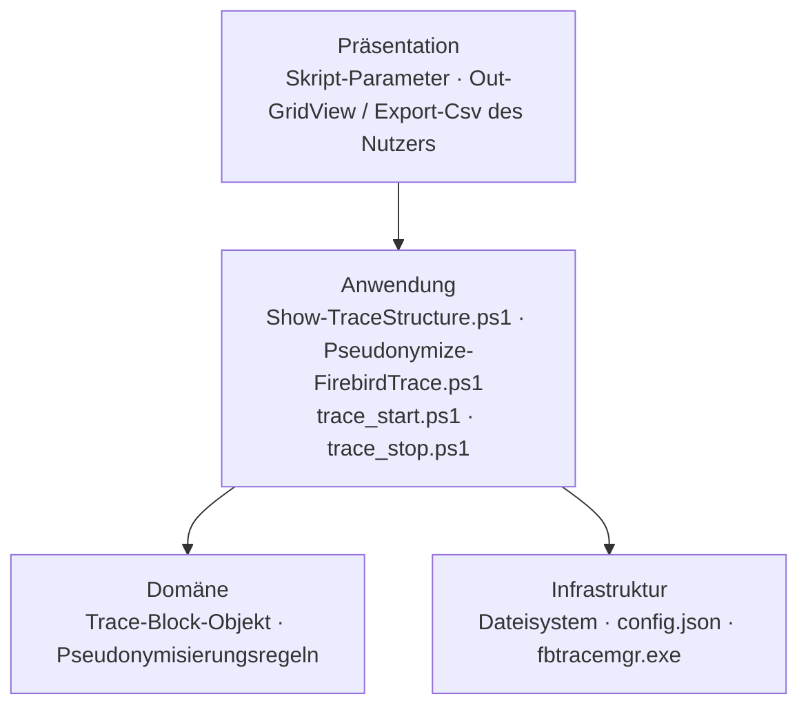

# Projekt-Layout – PSFirebirdTraceParser

Ordnerstruktur und Schichten-Modell. Das Projekt ist bewusst flach: vier eigenständige Skripte im Repo-Root,
die über die PowerShell-Pipeline kombiniert werden. Es gibt kein Modul und keine Unterordner für Quellcode.

Verbindet sich mit den Prinzipien [[SEPARATION_OF_CONCERNS]] und [[ORTHOGONALITY]].

---

## Schichten-Modell



**Regeln für Abhängigkeiten:**

- Pfeile zeigen erlaubte Aufrufrichtung (nur nach unten / nach innen).
- **Ist-Zustand:** Domäne und Anwendung sind je Skript nicht getrennt — Regex-Definitionen, Mapping und
  Ein-/Ausgabe stehen im selben Skriptkörper. Für Unit-Tests (ab I2/I6) wird die Logik in Funktionen geschnitten,
  die ohne Dateisystem und ohne `fbtracemgr` aufrufbar sind (z. B. „Block-Text → Objekt", „Objekt → pseudonymisiertes Objekt").
- Die Skripte rufen sich gegenseitig **nicht** auf; die Kopplung läuft ausschließlich über die Pipeline und die
  Property-Namen der Trace-Objekte (`features/TRACE_PARSING.md`).
- **Composition Root:** Der Nutzer bzw. die Pipeline-Zeile (`.\Show-TraceStructure.ps1 … | .\Pseudonymize-FirebirdTrace.ps1 …`).

---

## Ist-Layout

```
PSFirebirdTraceParser/
├── Show-TraceStructure.ps1         # Parser
├── Pseudonymize-FirebirdTrace.ps1  # Pseudonymisierer (Pipeline-Filter)
├── trace_start.ps1                 # Trace-Session starten
├── trace_stop.ps1                  # Trace-Session stoppen
├── fbtrace30.conf                  # Trace-Konfiguration für fbtracemgr
├── config.sample.json              # Vorlage; lokale config.json ist gitignored
├── README.md / README.de.md        # Nutzerdoku (englisch/deutsch)
├── AGENTS.md / CLAUDE.md           # Einstieg für Agenten → docs/KICKOFF.md
├── tools/git-hooks/                # Interna-Hook (pre-commit, commit-msg)
└── docs/                           # Dieses Doku-Set (docs/local/ gitignored)
```

## Ziel-Ergänzungen (mit dem jeweiligen Inkrement)

```
├── tests/                          # ab I2: Pester-Tests, je Skript eine *.Tests.ps1
│   ├── RequiredModules.psd1        # gepinnte Pester-Version
│   └── fixtures/                   # ab I6: synthetische Trace-Dateien mit fiktiven Daten
└── PSScriptAnalyzerSettings.psd1   # ab I2: Linter-Regeln für Gate 1
```

---

## Regeln

- **Ein Skript pro Aufgabe** im Repo-Root; neue Aufgaben als neues Skript mit genehmigtem Verb (`CONVENTIONS.md` §2).
- **Gemeinsam genutzte Logik** (heute: Konfig-Laden in beiden Trace-Skripten, doppelt vorhanden) erst bei einem
  zweiten echten Nutzer in eine `.psm1` auslagern (`CONVENTIONS.md` §3, [[DRY]] vs. [[YAGNI]]).
- **Tests parallel zur Quellstruktur:** `tests/<Skriptname>.Tests.ps1`.
- **Keine Laufzeitdaten im Repo:** Trace-Logs, Exporte und `config.json` bleiben außerhalb der Versionierung
  (`.gitignore`: `**/*.log`, `trace_output*`, `/*.csv`, `config*.json`).

---

## Schichtregel als ausführbarer Check

Derzeit nicht nötig: Es gibt keine Module und keine Imports zwischen den Skripten. Sobald ein `.psm1` oder
Dot-Sourcing eingeführt wird, kommt ein Pester-Test über den AST hinzu (Dot-Sourcing/`Import-Module` nur in
Richtung Infrastruktur → keine Rückwärtskanten), Teil von Gate 4 (`CONVENTIONS_COMMON.md` §5).

---

## Anti-Pattern

- **Skripte, die sich gegenseitig per Dateipfad aufrufen**, statt über die Pipeline zu kombinieren.
- **Ausgabe-Properties nebenbei umbenennen** — bricht Pseudonymisierer und Nutzer-Exporte still.
- **„Utils"-Skript als Sammelbecken** für Hilfsfunktionen ohne klare Aufgabe.

---

## Pflege

Trigger (siehe `KICKOFF.md` Phase 3a): neues Skript / Modul / Testordner oder Verschiebung von Logik zwischen
Skripten → diese Datei aktualisieren.
